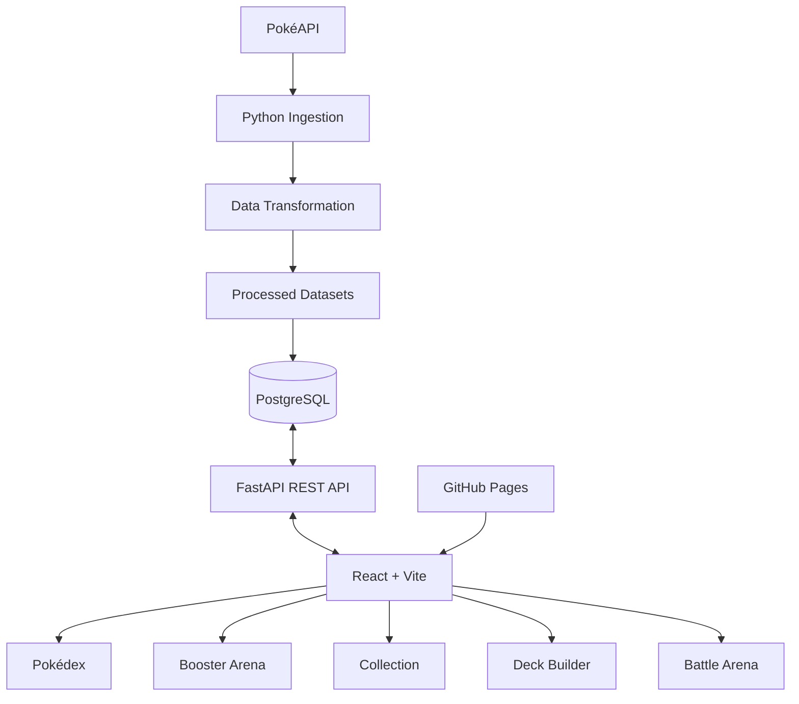

<div align="center">

# ⚡ POKÉMON NEXUS

### A Data-Driven Pokémon Trading Card Experience


<br/>


<br/>

[](https://iamgusta.github.io/Pokemon-nexus/)
[](https://github.com/iamgusta/Pokemon-nexus)

**Collect. Build. Battle. Discover.**

</div>

---

## 🌌 Overview

**Pokémon Nexus** is a full-stack Pokémon card collection and turn-based battle application, developed as a practical project combining **Data Engineering, Backend Development, Database Modeling and Frontend Engineering**.

The project processes information about **1,025 Pokémon**, stores structured data in PostgreSQL and exposes it through a FastAPI REST API.

Players can explore Pokémon, open booster packs, collect cards, build decks and battle against a computer-controlled opponent.

The application combines a data-oriented architecture with a gaming-inspired interface.

> [!IMPORTANT]
> The public GitHub Pages deployment is currently a **frontend showcase**. The complete gameplay is functional in the local development environment, where FastAPI and PostgreSQL are running.
>
> The public demo does not currently provide online access to the API, collections or battles.

---

## ✨ Features

### 🔎 Interactive Pokédex

- Explore 1,025 Pokémon.
- Search Pokémon by name.
- Filter by Pokémon type.
- View base statistics and abilities.
- Explore individual Pokémon profiles.
- Save favorites in the browser.

### 🎴 Pokémon Card Collection

- Collect cards through booster packs.
- Discover multiple card rarities.
- Store acquired cards in PostgreSQL.
- View collection details.
- Manage duplicate cards.

### 🎁 Booster Arena

- Open booster packs with 5 cards.
- Weighted rarity distribution.
- Cooldown system between openings.
- Persistent card collection.
- Booster opening history.

### 🛡️ Deck Builder

- Build custom decks containing 20 cards.
- Use Pokémon from the player's collection.
- Manage card quantities.
- Create, edit and delete decks.
- Save decks using the REST API.

### ⚔️ Battle Arena

- Turn-based battles against the CPU.
- Choose an existing Pokémon deck.
- Attack opposing Pokémon.
- Switch active Pokémon during combat.
- Track HP and knockouts.
- View battle logs.
- Persist battle state in PostgreSQL.

### 📊 Data Engineering

- Data extraction from PokéAPI.
- Data transformation using Python.
- Structured CSV processing.
- PostgreSQL persistence.
- Relational database modeling.
- REST API integration.

---

## 🏗️ System Architecture



The architecture separates data ingestion, transformation, persistence, business rules and user interface concerns.

---

## 🛠️ Technology Stack

| Layer | Technology | Responsibility |
|---|---|---|
| Data ingestion | Python | Retrieve Pokémon data |
| Data processing | Python, CSV | Transform and prepare datasets |
| Database | PostgreSQL | Relational persistence |
| Backend | FastAPI | REST API and game logic |
| Frontend | React | Interactive user interface |
| Build tool | Vite | Frontend development and build |
| Animation | Motion React | UI transitions and interactions |
| Styling | CSS3 | Game-inspired visual design |
| Version control | Git and GitHub | Source code management |
| Deployment | GitHub Actions | Automated frontend publishing |
| Frontend hosting | GitHub Pages | Public interface demo |

---

## 🎬 Motion & Visual Experience

Pokémon Nexus uses **Motion React** to bring a more dynamic gaming experience to the frontend.

Motion is used for:

- Animated card interactions.
- 3D-inspired card tilt effects.
- Page transitions.
- Opening and entrance animations.
- Pokémon battle interface transitions.
- HP bar animations.
- Interactive overlays and components.

### Example — Motion React

```jsx
import { motion } from "motion/react";

export default function AnimatedCard({ children }) {
  return (
    <motion.div
      initial={{ opacity: 0, y: 30 }}
      animate={{ opacity: 1, y: 0 }}
      whileHover={{
        y: -10,
        scale: 1.04
      }}
      whileTap={{ scale: 0.98 }}
      transition={{
        type: "spring",
        stiffness: 250,
        damping: 20
      }}
    >
      {children}
    </motion.div>
  );
}
```

This snippet demonstrates the animation approach used in the project.

---

## 🗃️ Database Design

The PostgreSQL database is responsible for Pokémon data and game progression.

### Core tables

| Table | Purpose |
|---|---|
| `pokemon` | Pokémon information |
| `pokemon_stats` | Base Pokémon statistics |
| `players` | Player records |
| `cards` | Card catalog |
| `player_cards` | Player card ownership |
| `booster_openings` | Booster history |
| `booster_opening_cards` | Cards received per opening |
| `decks` | Saved decks |
| `deck_cards` | Deck composition |
| `battle_matches` | Battle state and match records |

### Data Processing Pipeline

```text
PokéAPI
   |
   v
Python Ingestion
   |
   v
Raw Pokémon JSON
   |
   v
Data Transformation
   |
   v
Processed CSV
   |
   v
PostgreSQL
   |
   v
FastAPI
   |
   v
React Application
```

The dataset currently includes:

| Metric | Value |
|---|---:|
| Pokémon | 1,025 |
| Pokémon types | 18 |
| Abilities | 284 |
| Card catalog | 1,025 cards |
| Cards per booster | 5 |
| Cards per deck | 20 |

---

## 📁 Project Structure

```text
Pokemon-Nexus/
|
|-- .github/
|   `-- workflows/
|       `-- deploy.yml
|
|-- frontend/
|   |-- src/
|   |   |-- components/
|   |   |   |-- PokemonCard.jsx
|   |   |   |-- TcgCard.jsx
|   |   |   |-- TcgHub.jsx
|   |   |   |-- DeckBuilder.jsx
|   |   |   `-- BattleArena.jsx
|   |   |
|   |   |-- services/
|   |   |   `-- api.js
|   |   |
|   |   |-- styles/
|   |   |   |-- global.css
|   |   |   |-- tcg.css
|   |   |   |-- deck.css
|   |   |   `-- battle.css
|   |   |
|   |   |-- App.jsx
|   |   `-- main.jsx
|   |
|   |-- package.json
|   `-- vite.config.js
|
|-- sql/
|   `-- schema/
|       |-- 001_create_tables.sql
|       |-- 002_tcg_system.sql
|       |-- 003_battle_decks.sql
|       `-- 004_battle_system.sql
|
|-- src/
|   |-- api/
|   |   |-- routes/
|   |   `-- services/
|   |
|   |-- battle/
|   |   `-- battle_engine.py
|   |
|   |-- cards/
|   |   `-- card_generator.py
|   |
|   |-- database/
|   |   `-- connection.py
|   |
|   |-- ingestion/
|   |   `-- pokemon_api.py
|   |
|   |-- pipelines/
|   |   `-- pokemon_pipeline.py
|   |
|   |-- transformation/
|   |   `-- pokemon_transformer.py
|   |
|   `-- main.py
|
|-- .gitignore
`-- README.md
```

Local datasets, virtual environments, database credentials and installed dependencies are excluded from version control.

---

## 🚀 Getting Started

### Requirements

Before running the application, install:

- Python 3
- Node.js and npm
- PostgreSQL
- Git

### 1. Clone the repository

```bash
git clone https://github.com/iamgusta/Pokemon-nexus.git
cd Pokemon-nexus
```

### 2. Create a Python virtual environment

On Windows PowerShell:

```powershell
python -m venv .venv
.\.venv\Scripts\Activate.ps1
```

### 3. Install Python packages

```powershell
python -m pip install fastapi "uvicorn[standard]" psycopg2-binary python-dotenv pandas requests
```

### 4. Configure PostgreSQL

Create a local database called:

```sql
CREATE DATABASE pokemon_nexus;
```

Configure the environment variables required by `src/database/connection.py`.

The `.env` file must remain private and must not be committed to Git.

### 5. Create the database schema

Run the SQL scripts in numerical order:

```text
001_create_tables.sql
002_tcg_system.sql
003_battle_decks.sql
004_battle_system.sql
```

Initialize the Pokémon dataset and card catalog using the project's ingestion, transformation and card generation modules.

### 6. Start the FastAPI server

From the project root:

```powershell
python -m uvicorn src.main:app --reload --port 8001
```

API documentation:

http://127.0.0.1:8001/docs

### 7. Start the React frontend

Open another terminal:

```powershell
cd frontend
npm ci
npm run dev
```

Open:

http://127.0.0.1:5173

The frontend requires the local FastAPI server and populated PostgreSQL database for complete gameplay.

---

## 🔌 REST API

The application includes endpoints for retrieving Pokémon data and managing the card game.

| Method | Endpoint | Description |
|---|---|---|
| GET | `/api/pokemon` | List Pokémon |
| GET | `/api/pokemon/{id}` | Pokémon details |
| GET | `/api/stats` | Global statistics |
| GET | `/api/boosters/status` | Booster availability |
| POST | `/api/boosters/open` | Open a booster |
| GET | `/api/boosters/history` | Booster history |
| GET | `/api/collection` | Player collection |
| GET | `/api/decks` | List decks |
| POST | `/api/decks` | Create a deck |
| PUT | `/api/decks/{id}` | Update a deck |
| DELETE | `/api/decks/{id}` | Delete a deck |
| POST | `/api/battles/start` | Start a battle |
| GET | `/api/battles/{id}` | Battle information |
| POST | `/api/battles/{id}/turn` | Execute a battle turn |

### Example — Start a Battle

```http
POST /api/battles/start
Content-Type: application/json
```

```json
{
  "deck_id": 1
}
```

### Example — Attack

```http
POST /api/battles/1/turn
Content-Type: application/json
```

```json
{
  "action": "attack",
  "target_index": null
}
```

---

## 🎴 Game Mechanics

### Card Rarities

Pokémon cards are assigned rarities based on predefined catalog rules and Pokémon statistics.

| Rarity | Booster Probability |
|---|---:|
| Common | 55% |
| Uncommon | 27% |
| Rare | 12% |
| Epic | 5% |
| Legendary | 1% |

### Battle Rules

- Each deck contains 20 cards.
- Battles are turn-based.
- Players can attack or switch Pokémon.
- Pokémon have HP, attack and defense attributes.
- The first side to achieve five knockouts wins.
- Battle state is persisted in PostgreSQL.

These are custom Pokémon Nexus mechanics, not an implementation of the official Pokémon Trading Card Game rules.

---

## 🌐 Deployment

### Frontend

The public frontend is hosted on GitHub Pages.

**Live Demo:**

https://iamgusta.github.io/Pokemon-nexus/

GitHub Actions automatically builds the Vite application when changes are pushed to the `main` branch.

### Backend and Database

The FastAPI backend and PostgreSQL database currently run locally.

The public deployment therefore serves as an interactive UI showcase rather than a fully playable online multiplayer or account-based game.

---

## 🎯 Engineering Goals

This project was created to demonstrate practical experience in:

- Python programming.
- Data ingestion and transformation.
- Relational database modeling.
- PostgreSQL and SQL.
- API development with FastAPI.
- Frontend development with React.
- Component animation using Motion React.
- Full-stack integration.
- Git version control.
- CI/CD with GitHub Actions.

---

## 🔮 Future Improvements

- [ ] Player registration and authentication.
- [ ] Individual player collections and accounts.
- [ ] Experience points and trainer progression.
- [ ] Battle rewards and achievements.
- [ ] Battle history dashboard.
- [ ] Advanced card visual effects.
- [ ] Expanded gameplay mechanics.
- [ ] Public backend deployment.
- [ ] Cloud PostgreSQL integration.
- [ ] Automated tests and monitoring.

---

## 👨‍💻 Developer

**Gustavo Lopes da Silva**

Information Systems Undergraduate  
Aspiring Data Engineer

Focused on building practical projects involving Python, SQL, data pipelines, relational databases and modern application development.

[](https://github.com/iamgusta)

---

## ⚠️ Disclaimer

Pokémon Nexus is an independent, non-commercial educational portfolio project.

Pokémon names, characters and related trademarks belong to their respective owners.

This project is not affiliated with, sponsored by or endorsed by Nintendo, Game Freak, Creatures Inc. or The Pokémon Company.

---

<div align="center">

### ⚡ BUILT WITH DATA. POWERED BY IMAGINATION.

**Pokémon Nexus © 2026**

Python · PostgreSQL · FastAPI · React · Motion

</div>
