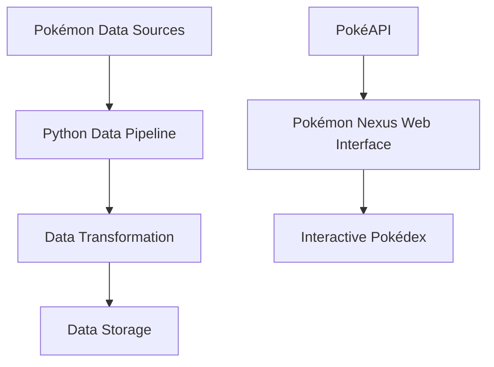

<div align="center">

# ⚡ POKÉMON NEXUS

### Data Engineering Meets the Pokémon Universe

**An interactive Pokémon data exploration project**


<br>

[](https://iamgusta.github.io/Pokemon-nexus/)

[Source Code](https://github.com/iamgusta/Pokemon-nexus)

</div>

---

## 🌌 Project Overview

**Pokémon Nexus** is a Pokémon-inspired technology project combining data engineering concepts with modern web development.

It demonstrates data exploration, API integration, data organization, and interactive visualization through an accessible web experience.

The project also includes Python-based components organized around data pipelines and transformations.

## ✨ Interactive Features

- Interactive Pokémon catalog
- Search by Pokémon name or Pokédex ID
- Region-based filtering
- Pokémon attributes and base statistics
- Random Pokémon discovery
- Animated interface and responsive design
- PokéAPI integration

## 🏗️ Architecture



**Note:** The architecture illustrates the project's broader data engineering concept. The current interactive Pokédex retrieves data directly from PokéAPI.

## 🧰 Technologies

| Technology | Purpose |
|---|---|
| Python | Data processing and pipelines |
| JavaScript | Interactive UI and API requests |
| HTML5 | Interface structure |
| CSS3 | Responsive styling and animations |
| PokéAPI | Pokémon data retrieval |
| Git & GitHub | Version control |

## 🚀 Getting Started

Clone the repository:

```bash
git clone https://github.com/iamgusta/Pokemon-nexus.git
```

Enter the directory:

```bash
cd Pokemon-nexus
```

Open `index.html` in your browser.

An internet connection is required to retrieve Pokémon data.

## 🗺️ Roadmap

- [x] Interactive Pokédex
- [x] Search and region filters
- [x] Pokémon statistics
- [x] Responsive interface
- [ ] Local database integration
- [ ] Data analytics dashboard
- [ ] Pokémon card collection
- [ ] Turn-based battle system

## 👨‍💻 Developer

**Gustavo Lopes da Silva**

Information Systems Undergraduate

Data Engineering | Python | SQL | ETL | Data Pipelines

[GitHub Profile](https://github.com/iamgusta)

---

<div align="center">

### Gotta Analyze 'Em All!

**Built with passion for Pokémon, technology, and data.**

Pokémon and associated names and imagery belong to their respective owners.

This is an independent educational and portfolio project.

</div>
  